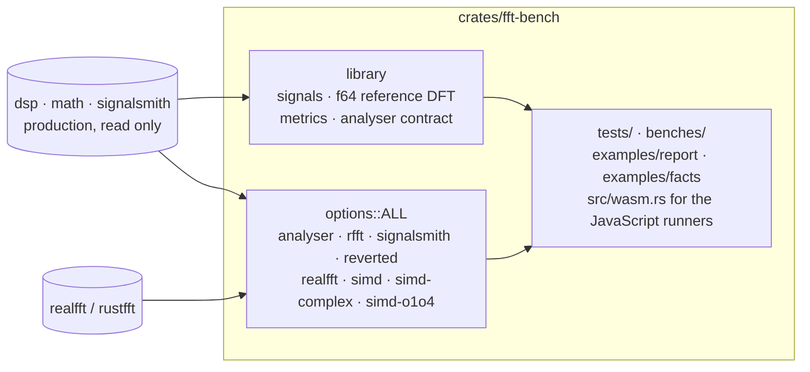
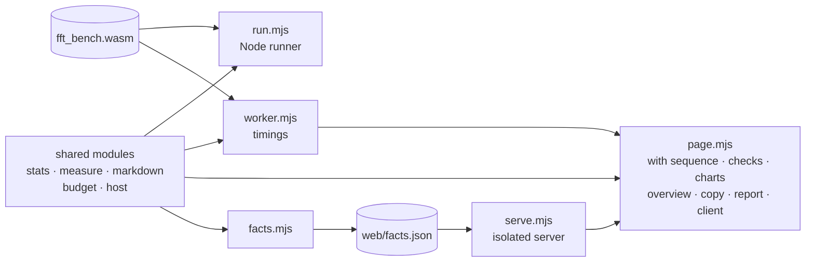

# Architecture

How the harness is built and why.

## Contents

- [Overview](#overview)
- [The interface](#the-interface)
- [Registry and roles](#registry-and-roles)
- [Options and adapters](#options-and-adapters)
- [Build setup and dependencies](#build-setup-and-dependencies)
- [Size and no_std stubs](#size-and-no_std-stubs)
- [Facts file](#facts-file)
- [JavaScript runners and the browser page](#javascript-runners-and-the-browser-page)

## Overview

**How to read the diagram:** arrow A → B means B uses A. Cylinders are crates outside the harness.



Production crates (`dsp`, `signalsmith`) are only read. Everything that must not change in them
(copies, adapters, the reverted variant) lives in the harness.

## The interface

```rust
pub trait RealFft {
    fn new(n: usize) -> Self where Self: Sized;
    fn size(&self) -> usize;
    fn forward(&mut self, input: &[f32], re: &mut [f32], im: &mut [f32]);
    fn inverse(&mut self, re: &[f32], im: &[f32], output: &mut [f32]) -> bool;
    // For benchmarks; defaults: no preparation, kernel = forward/inverse.
    fn prepare_forward(&mut self, input: &[f32]) {}
    fn forward_kernel(&mut self, input: &[f32], re: &mut [f32], im: &mut [f32]) { … }
    fn prepare_inverse(&mut self, re: &[f32], im: &[f32]) {}
    fn inverse_kernel(&mut self, re: &[f32], im: &[f32], output: &mut [f32]) -> bool { … }
    // Stage-wise options only (0 steps otherwise): forward in steps, one call per render quantum.
    fn steps(&self) -> usize { 0 }
    fn run_step(&mut self, step: usize) {}
}
```

| Rule                       | Why |
|----------------------------|-----|
| `*_kernel` is the option's native call; `prepare_*` puts the data where the kernel reads it, untimed | benchmarks time the transform, not adapter copies; `forward`/`inverse` are built from the same two steps, so the accuracy tests cover exactly the timed code |
| Real input, n/2 + 1 bins out, split re/im | the layout of `dsp::rfft` and of the `simd` kernel; audio is real |
| Unnormalised forward, identity round trip | matches `dsp::rfft`; adapters scale where an option differs |
| Only `new` allocates       | the engine never allocates on the render path |
| `&mut self`                | each option owns its scratch, created in `new` |
| `inverse -> bool`          | the analyser has no inverse; round-trip tests skip it instead of failing |
| `where Self: Sized` on `new` | keeps the trait usable as `Box<dyn RealFft>` |

## Registry and roles

`options::ALL` lists every option once: name, role, whether it is a full complex transform (`complex`:
one call can carry two real channels, which the budget model uses) and a `create` function pointer
(`create::<T>`, no closures, so the list is a `const`). Tests, the report, the benchmarks and the wasm
exports iterate over it; a new option is measured everywhere by adding one entry.

| Role        | Options                                   | Treatment in tests |
|-------------|-------------------------------------------|--------------------|
| `Baseline`  | `analyser`, `rfft`, `signalsmith`, `reverted` | sanity bounds; `rfft` sets the candidate gate |
| `Candidate` | `realfft`, `simd`, `simd-complex`, `simd-o1o4` | candidate gates |

## Options and adapters

| Option        | Source                                  | Adapter |
|---------------|-----------------------------------------|---------|
| `analyser`    | copy of `AudioAnalyser`, one compiled instance per size (`AnalyserFixed<N, HALF>`, fixed arrays like the original) | `AnalyserKernel` hides the size; `analyser_for(n)` picks the instance; `AnalyserFft` wraps it. A slice-based copy was ≈ 15 % slower, this one matches the original |
| `rfft`        | `dsp::rfft::FftTables`, called directly | none; its API already matches. Built in zeroed heap memory, as `FftTables` has no constructor |
| `signalsmith` | `signalsmith::fft::Fft`                 | `ComplexAsReal`: `im = 0` before forward, Hermitian mirror before inverse. `SignalsmithStretch` puts the right channel into `im` instead (two real channels per call); the FFT's cost is the same |
| `reverted`    | `signalsmith/src/fft.rs` at `7998a6b64`, verbatim | `ComplexAsReal`; the used part of its `simd.rs` copied verbatim beside it |
| `realfft`     | `realfft` 3.5 / `rustfft` 6.4           | interleaved `Complex<f32>` ↔ split; inverse scaled by 1/n; input copied (realfft uses it as scratch) |
| `simd`        | `src/options/simd/kernel.rs` (prototype, [how it works](simd-kernel.md)) | none; its real FFT already matches `RealFft` |
| `simd-complex`| the same kernel's complex `Fft`         | `ComplexAsReal`; its stages are the steps of the stage-wise API |
| `simd-o1o4`   | `src/options/outlook/kernel.rs` with the items O1 and O4 ([outlook](simd-outlook.md)) | none; also the stage `S0+O1+O4` of the stages page |

**Accuracy:** every test signal goes through each option and through the f64 reference DFT; `metrics` compares
the two, the tests apply the thresholds, the report prints the values. For the output contract,
`contract::analyser_bins` runs any option through the analyser's window and magnitude steps.

`ComplexAsReal<F: ComplexFft>` is the one adapter for full complex FFTs; `ComplexFft` is implemented
for `signalsmith::fft::Fft`, the reverted copy and the `simd` kernel by forwarding to their own methods. Its
methods take `&mut self`, because the Stockham kernel ping-pongs through work buffers it owns.

The kernel files (`kernel.rs`, `v4.rs`) use only `core` and `alloc`, so the size stub compiles them directly.
`v4.rs` has a wasm SIMD128 implementation and a scalar `[f32; 4]` one with the same operations in the same order:
the native tests check the wasm algorithm bit for bit.

## Build setup and dependencies

- **Own workspace:** excluded in `crates/Cargo.toml`, with its own `Cargo.lock` and `target/`, so `realfft` and
  the benchmark tools never reach the engine's lockfile or CI.
- **As the engine builds:** `+simd128` for wasm32 (`.cargo/config.toml`), release with opt-level 3, LTO and
  `panic = "abort"`; `realfft` gets its `wasm_simd` feature on wasm32.
- **Tests at opt-level 3** (`[profile.test]`): the O(n²) reference DFT is too slow unoptimised.
- **One wasm module, no imports:** `crate-type = lib + cdylib`, exports in `src/wasm.rs`, so
  `WebAssembly.instantiate(bytes, {})` works in Node and in a browser Worker.
- **Dependencies:** `dsp`, `math`, `signalsmith` (path, read only), `libm` (twiddle and window tables) and
  `realfft` (which brings `rustfft` and six small crates).

## Size and no_std stubs

`size/` is a cargo workspace of its own (own lockfile and `target/`), built only for `wasm32-unknown-unknown`.
Each stub is one small module that calls one option the way its consumer does, at a runtime size.

| Stub | What it links | Used for |
|---|---|---|
| `support` | a bump allocator and a panic handler, `no_std` | stands in for the engine's runtime (talc, its panic handler) |
| `empty` | `support` only | size baseline of the `no_std` stubs |
| `analyser`, `rfft`, `signalsmith` | `support` + the option's crate | `no_std` link check and size |
| `simd` | `support` + the kernel files via `#[path]` | `no_std` link check and size |
| `simd-o1o4` | `support` + the `simd` and outlook kernel files via `#[path]`, re-exported under their harness paths | `no_std` link check and size |
| `realfft` | `support` + `realfft`, `no_std` | `no_std` link check (fails: `std` brings its own panic handler) |
| `empty-std`, `realfft-std` | plain `std` modules | size of `realfft` where it can link |

Build settings mirror the engine: `+simd128` (`size/.cargo/config.toml`), opt-level 3, LTO, abort, strip;
`size.sh` then runs `wasm-opt -Oz` with the feature set of `build-wasm.sh` and gzip -9. Both scripts print
Markdown, or JSON with `--json` for `facts.mjs`.

## Facts file

The page cannot measure accuracy, allocations, size or `no_std` in a browser. `node facts.mjs` collects them:

| Producer | Gives |
|---|---|
| `examples/facts.rs` | accuracy gates and allocation counts per option, as JSON; same thresholds as the tests |
| `size/size.sh --json` | wasm size added and crates pulled in per stub |
| `size/nostd-check.sh --json` | whether each stub links `no_std` |

It writes `web/facts.json` with the git hash, date and `rustc` version, and the server reports it as stale when
any Rust source is newer.

## JavaScript runners and the browser page

The wasm module is driven from JavaScript twice: by `run.mjs` in Node and by the pages in `web/`. Both share
the statistics, the measurements, the Markdown tables and the budget model, so a browser report and
`node.md` are built by the same code and compare section by section. A third, `bits.mjs`, is a check, not a
runner: it compares the module's `simd` and `simd-complex` output with the native bits from `examples/bits.rs`.

`serve.mjs` serves four pages: a static landing page at `/` (`index.html`) that explains the two rounds of
optimisation and links the others, the decision page at `/decision` (`decision.html`, `page.mjs`), the stages page at
`/stages` (`stages.html`, `stages.mjs` with `stages-copy.mjs`) and the worklet page at `/worklet` (`worklet.html`,
`worklet.mjs`). The measuring pages share the Worker, the client, the checks, the sequence and the charts below.

**How to read the diagram:** arrow A → B means B uses A (imports it, loads it or is served it).



| Part | Role |
|---|---|
| `serve.mjs` | serves an allowlist of files on `127.0.0.1` with `Cross-Origin-Opener-Policy` and `Cross-Origin-Embedder-Policy`, so browsers give the page their finest timer; `/environment` reports git hash, CPU, OS and whether the module and `web/facts.json` are older than their sources |
| `worker.mjs` | loads the module and runs every measurement off the main thread; also measures the timer tick and checks isolation and SIMD128 there, because that is the timer the measurements use |
| `client.mjs` | request and answer over the Worker by id; a Worker that fails to load rejects every pending request |
| `page.mjs` | runs the seven steps of `sequence.mjs` (one by one or with **Run all**), renders tables and charts, writes the report |
| `overview.mjs` | the decision overview: one row per criterion from this run's timings and `web/facts.json`; HTML for the page, Markdown for the report; a missing or malformed facts file shows as missing |
| `copy.mjs` | the page's text: intro, glossary and one reading hint per table and chart |
| `checks.mjs` | timer tick, batch length `max(10 ms, 500 × tick)`, SIMD128 probe, browser name, step outcomes |
| `sequence.mjs` | the fixed step order: a step runs only after the one before passed; any new result resets every later step |
| `charts.mjs` | SVG line and bar charts without a library; colours from CSS custom properties |
| `report.mjs` | the browser run as Markdown in the `node.md` format |
| `worklet.mjs` | the worklet page: the same options timed in the Worker and in an AudioWorklet, offline and in real time; with `worklet-copy.mjs` for its text |
| `worklet-processor.mjs` | the `AudioWorkletProcessor`: instantiates the module it is sent, hashes every case (mode `bits`) or runs one scheduled batch per render quantum (mode `timing`) |
| `worklet-logic.mjs` | shared by processor, Worker and page: block schedule, record layout, calibration, drop rule, FNV-1a digests; no `TextDecoder`, which a worklet lacks |
| `clock.mjs` | spins `performance.now()` into a `SharedArrayBuffer` for the worklet, as the studio's `HRClockWorker` does |

**Why a Worker, not an AudioWorklet.** An AudioWorklet has no high-resolution clock, and browser timers
are coarse unless the page is cross-origin isolated (Chrome: 100 µs, isolated 5 µs). A Worker in an
isolated page has the fine timer and runs the same wasm engine. It is not the audio thread, so a
scheduling effect specific to that thread would not show. The decision and stages pages therefore time in a Worker.

**The worklet page.** It answers whether the audio thread changes the picture. The clock is `clock.mjs`, a Worker
spinning `performance.now()` into shared memory (the approach of `plans/dsp-load-measurement.md`); the processor
reads it before and after one batch per render quantum. Per round and option-size job the schedule is: one block
`setup`, one block calibration (calls per batch for about 25 % of the quantum), then pairs of batches without and with
the FFT. A pair's difference divided by the calls is one sample, so the cost of reading the clock cancels. Jobs take
turns within a round; round 0 is warm-up and not counted. A kernel batch whose two clock reads are equal is dropped
(the clock Worker was descheduled); a batch without the kernel may fit in one tick, so equal reads are valid there.
Results go into `SharedArrayBuffer`s; the processor never allocates or posts while timing. The module is compiled on
the main thread and sent as a `WebAssembly.Module` in `processorOptions`, or as bytes where a browser cannot clone a
module.

**Why steps are timed by difference.** A single step (0.4–24 µs) is near the browser tick. Step k is
timed as a batch of "preparation + steps 0..k−1" with and without step k, so each step runs on the data
its predecessors produced and needs no extra Rust export. Unlike throughput, whose batches run inside
wasm, a step batch loops in JavaScript, so step k carries one extra JS→wasm call (about 10 ns), a few
percent at most on the smallest steps.
