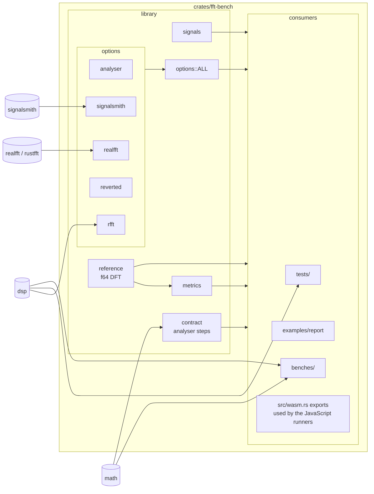
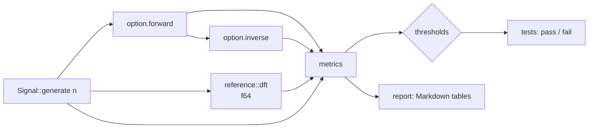
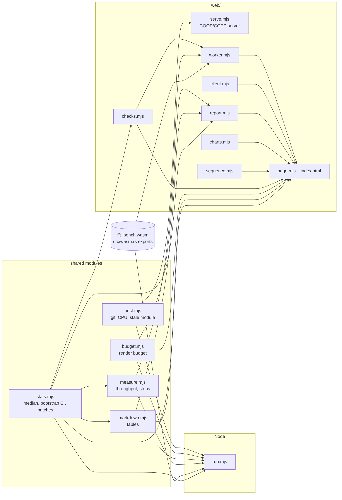

# Architecture

How the harness is built and why.

## Contents

- [Overview](#overview)
- [The interface](#the-interface)
- [Registry and roles](#registry-and-roles)
- [Options and adapters](#options-and-adapters)
- [Accuracy data flow](#accuracy-data-flow)
- [Build setup](#build-setup)
- [Dependencies](#dependencies)
- [Size and no_std stubs](#size-and-no_std-stubs)
- [JavaScript runners and the browser page](#javascript-runners-and-the-browser-page)

## Overview

**How to read the diagram**

- **Direction:** left to right, from the crates the harness reads, through its library (`src/`), to
  the code that runs it (tests, report, benchmarks).
- **Arrow A → B:** B uses A (imports it).
- **Arrow into a box:** members of the box use A, not necessarily every member (the benchmarks, for
  example, need no reference DFT and no metrics).
- **Outer box `crates/fft-bench`:** the harness crate. Inside it, `library` is `src/`, `options`
  holds one module per FFT option, and `consumers` holds everything that runs the library.
- **Cylinders:** crates outside the harness. `dsp`, `signalsmith` and `math` are production crates,
  only read; `realfft / rustfft` comes from crates.io.
- **Not drawn:** the crate root (`RealFft`, `SIZES`, `bins`), used almost everywhere, and `libm`.



Production crates (`dsp`, `signalsmith`) are only read. Everything that must not change in them
(copies, adapters, the reverted variant) lives in the harness.

## The interface

```rust
pub trait RealFft {
    fn new(n: usize) -> Self where Self: Sized;
    fn size(&self) -> usize;
    fn forward(&mut self, input: &[f32], re: &mut [f32], im: &mut [f32]);
    fn inverse(&mut self, re: &[f32], im: &[f32], output: &mut [f32]) -> bool;
    // For benchmarks; defaults: no preparation, kernel = forward/inverse.
    fn prepare_forward(&mut self, input: &[f32]) {}
    fn forward_kernel(&mut self, input: &[f32], re: &mut [f32], im: &mut [f32]) { … }
    fn prepare_inverse(&mut self, re: &[f32], im: &[f32]) {}
    fn inverse_kernel(&mut self, re: &[f32], im: &[f32], output: &mut [f32]) -> bool { … }
    // Stage-wise options only (0 steps otherwise): forward in steps, one call per render quantum.
    fn steps(&self) -> usize { 0 }
    fn run_step(&mut self, step: usize) {}
}
```

| Rule                       | Why |
|----------------------------|-----|
| `*_kernel` is the option's native call; `prepare_*` puts the data where the kernel reads it, untimed | benchmarks time the transform, not adapter copies; `forward`/`inverse` are built from the same two steps, so the accuracy tests cover exactly the timed code |
| Real input, n/2 + 1 bins out, split re/im | the layout of `dsp::rfft` and of the planned kernel; audio is real |
| Unnormalised forward, identity round trip | matches `dsp::rfft`; adapters scale where an option differs |
| Only `new` allocates       | the engine never allocates on the render path |
| `&mut self`                | each option owns its scratch, created in `new` |
| `inverse -> bool`          | the analyser has no inverse; round-trip tests skip it instead of failing |
| `where Self: Sized` on `new` | keeps the trait usable as `Box<dyn RealFft>` |

## Registry and roles

`options::ALL` lists every option once: name, role, whether it is a full complex transform (`complex`:
one call can carry two real channels, which the budget model uses) and a `create` function pointer
(`create::<T>`, no closures, so the list is a `const`). Tests, the report, the benchmarks and the wasm
exports iterate over it; a new option is measured everywhere by adding one entry.

| Role        | Options                                   | Treatment in tests |
|-------------|-------------------------------------------|--------------------|
| `Baseline`  | `analyser`, `rfft`, `signalsmith`, `reverted` | sanity bounds; `rfft` sets the candidate gate |
| `Candidate` | `realfft`, prototype (planned)            | candidate gates    |

## Options and adapters

| Option        | Source                                  | Adapter |
|---------------|-----------------------------------------|---------|
| `analyser`    | copy of `AudioAnalyser`, one compiled instance per size (`AnalyserFixed<N, HALF>`, fixed arrays like the original) | `AnalyserKernel` hides the size; `analyser_for(n)` picks the instance; `AnalyserFft` wraps it. A slice-based copy was ≈ 15 % slower, this one matches the original |
| `rfft`        | `dsp::rfft::FftTables`, called directly | none; its API already matches. Built in zeroed heap memory, as `FftTables` has no constructor |
| `signalsmith` | `signalsmith::fft::Fft`                 | `ComplexAsReal`: `im = 0` before forward, Hermitian mirror before inverse. `SignalsmithStretch` puts the right channel into `im` instead (two real channels per call); the FFT's cost is the same |
| `reverted`    | `signalsmith/src/fft.rs` at `7998a6b64`, verbatim | `ComplexAsReal`; the used part of its `simd.rs` copied verbatim beside it |
| `realfft`     | `realfft` 3.5 / `rustfft` 6.4           | interleaved `Complex<f32>` ↔ split; inverse scaled by 1/n; input copied (realfft uses it as scratch) |

`ComplexAsReal<F: ComplexFft>` is the one adapter for full complex FFTs; `ComplexFft` is implemented
for `signalsmith::fft::Fft` and the reverted copy by forwarding to their own methods.

## Accuracy data flow



For the output contract, `contract::analyser_bins` runs any option through the analyser's window and
magnitude steps; `metrics::contract_deviation` compares the bins with the analyser copy's.

## Build setup

| Aspect            | Setting | Why |
|-------------------|---------|-----|
| Workspace         | excluded in `crates/Cargo.toml`, own `Cargo.lock` | `realfft` and benchmark tools never reach the engine's lockfile or CI; same as `signalsmith-wasmbench` |
| `target/`         | ignored in `crates/.gitignore` | build output stays out of git |
| `[profile.test]`  | `opt-level = 3` | the O(n²) reference DFT |
| `std`             | yes | test harness, `realfft`; the options themselves stay `no_std`-compatible except `realfft` |
| `extern crate alloc` | in `lib.rs` | lets the verbatim copy keep its `use alloc::vec::Vec` |
| `realfft` on wasm32 | `wasm_simd` feature | rustfft only takes its SIMD128 path with it |
| `crate-type`      | `lib` + `cdylib` | the wasm32 build becomes a loadable module with the exports of `src/wasm.rs` |
| `.cargo/config.toml` | `+simd128` for wasm32 | as the engine's wasm build; no `RUSTFLAGS` to remember |
| `[profile.release]` | opt-level 3, LTO, `panic = "abort"` | as the engine builds its DSP crates |
| wasm imports      | none | `WebAssembly.instantiate(bytes, {})` works in Node and in a browser Worker |

## Dependencies

| Crate          | Kind      | Used by |
|----------------|-----------|---------|
| `dsp`          | path      | `rfft` option, `AudioAnalyser` in tests |
| `math`         | path      | `math::sqrt` in the analyser contract |
| `signalsmith`  | path      | `signalsmith` option |
| `libm`         | crates.io | twiddle and window tables (as the originals) |
| `realfft`      | crates.io | `realfft` option; brings `rustfft`, `num-complex`, `num-traits`, `num-integer`, `strength_reduce`, `transpose`, `primal-check`, `autocfg` |

## Size and no_std stubs

`size/` is a cargo workspace of its own (own lockfile and `target/`), built only for `wasm32-unknown-unknown`.
Each stub is one small module that calls one option the way its consumer does, at a runtime size.

| Stub | What it links | Used for |
|---|---|---|
| `support` | a bump allocator and a panic handler, `no_std` | stands in for the engine's runtime (talc, its panic handler) |
| `empty` | `support` only | size baseline of the `no_std` stubs |
| `analyser`, `rfft`, `signalsmith` | `support` + the option's crate | `no_std` link check and size |
| `realfft` | `support` + `realfft`, `no_std` | `no_std` link check (fails: `std` brings its own panic handler) |
| `empty-std`, `realfft-std` | plain `std` modules | size of `realfft` where it can link |

Build settings mirror the engine: `+simd128` (`size/.cargo/config.toml`), opt-level 3, LTO, abort, strip;
`size.sh` then runs `wasm-opt -Oz` with the feature set of `build-wasm.sh` and gzip -9.

## JavaScript runners and the browser page

The wasm module is driven from JavaScript twice: by `run.mjs` in Node and by the page in `web/`. Both share
the statistics, the measurements, the Markdown tables and the budget model, so a browser report and
`node.md` are built by the same code and compare section by section.

**How to read the diagram:** arrow A → B means B imports A; the one exception is `worker.mjs`, which the
page starts as a Worker. Boxes on the left are shared by both runners; `web/` holds what only the page uses.



| Part | Role |
|---|---|
| `serve.mjs` | serves an allowlist of files on `127.0.0.1` with `Cross-Origin-Opener-Policy` and `Cross-Origin-Embedder-Policy`, so browsers give the page their finest timer; `/environment` reports git hash, CPU, OS and whether the module is older than its sources |
| `worker.mjs` | loads the module and runs every measurement off the main thread; also measures the timer tick and checks isolation and SIMD128 there, because that is the timer the measurements use |
| `client.mjs` | request and answer over the Worker by id; a Worker that fails to load rejects every pending request |
| `page.mjs` | runs the seven steps of `sequence.mjs` in order, renders tables and charts, writes the report |
| `checks.mjs` | timer tick, batch length `max(10 ms, 500 × tick)`, SIMD128 probe, browser name, step outcomes |
| `sequence.mjs` | the fixed step order: a step runs only after the one before passed; any new result resets every later step |
| `charts.mjs` | SVG line and bar charts without a library; colours from CSS custom properties |
| `report.mjs` | the browser run as Markdown in the `node.md` format |

**Why a Worker, not an AudioWorklet.** An AudioWorklet has no high-resolution clock, and browser timers
are coarse unless the page is cross-origin isolated (Chrome: 100 µs, isolated 5 µs). A Worker in an
isolated page has the fine timer and runs the same wasm engine. It is not the audio thread, so a
scheduling effect specific to that thread would not show; whether that matters is a question for the
maintainer.

**Why steps are timed by difference.** A single step (0.4–24 µs) is near the browser tick. Step k is
timed as a batch of "preparation + steps 0..k−1" with and without step k, so each step runs on the data
its predecessors produced and needs no extra Rust export. Unlike throughput, whose batches run inside
wasm, a step batch loops in JavaScript, so step k carries one extra JS→wasm call (about 10 ns), a few
percent at most on the smallest steps.
