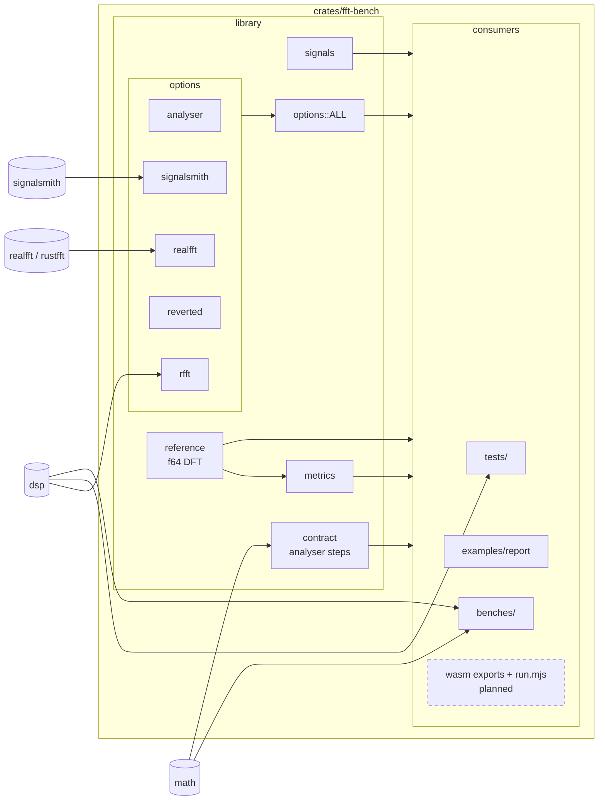
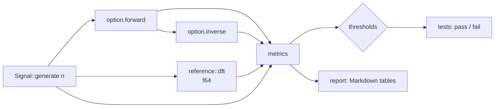

# Architecture

How the harness is built and why. Parts marked *planned* do not exist yet.

## Contents

- [Overview](#overview)
- [The interface](#the-interface)
- [Registry and roles](#registry-and-roles)
- [Options and adapters](#options-and-adapters)
- [Accuracy data flow](#accuracy-data-flow)
- [Build setup](#build-setup)
- [Dependencies](#dependencies)
- [Planned parts](#planned-parts)

## Overview

**How to read the diagram**

- **Direction:** left to right, from the crates the harness reads, through its library (`src/`), to
  the code that runs it (tests, report, benchmarks).
- **Arrow A → B:** B uses A (imports it).
- **Arrow into a box:** members of the box use A, not necessarily every member (the benchmarks, for
  example, need no reference DFT and no metrics).
- **Outer box `crates/fft-bench`:** the harness crate. Inside it, `library` is `src/`, `options`
  holds one module per FFT option, and `consumers` holds everything that runs the library.
- **Cylinders:** crates outside the harness. `dsp`, `signalsmith` and `math` are production crates,
  only read; `realfft / rustfft` comes from crates.io.
- **Dashed outline:** planned, does not exist yet.
- **Not drawn:** the crate root (`RealFft`, `SIZES`, `bins`), used almost everywhere, and `libm`.



Production crates (`dsp`, `signalsmith`) are only read. Everything that must not change in them
(copies, adapters, the reverted variant) lives in the harness.

## The interface

```rust
pub trait RealFft {
    fn new(n: usize) -> Self where Self: Sized;
    fn size(&self) -> usize;
    fn forward(&mut self, input: &[f32], re: &mut [f32], im: &mut [f32]);
    fn inverse(&mut self, re: &[f32], im: &[f32], output: &mut [f32]) -> bool;
    // For benchmarks; defaults: no preparation, kernel = forward/inverse.
    fn prepare_forward(&mut self, input: &[f32]) {}
    fn forward_kernel(&mut self, input: &[f32], re: &mut [f32], im: &mut [f32]) { … }
    fn prepare_inverse(&mut self, re: &[f32], im: &[f32]) {}
    fn inverse_kernel(&mut self, re: &[f32], im: &[f32], output: &mut [f32]) -> bool { … }
}
```

| Rule                       | Why |
|----------------------------|-----|
| `*_kernel` is the option's native call; `prepare_*` loads data as its consumer does, untimed | benchmarks time the transform, not adapter copies; `forward`/`inverse` are built from the same two steps, so the accuracy tests cover exactly the timed code |
| Real input, n/2 + 1 bins out, split re/im | the layout of `dsp::rfft` and of the planned kernel; audio is real |
| Unnormalised forward, identity round trip | matches `dsp::rfft`; adapters scale where an option differs |
| Only `new` allocates       | the engine never allocates on the render path |
| `&mut self`                | each option owns its scratch, created in `new` |
| `inverse -> bool`          | the analyser has no inverse; round-trip tests skip it instead of failing |
| `where Self: Sized` on `new` | keeps the trait usable as `Box<dyn RealFft>` |

## Registry and roles

`options::ALL` lists every option once: name, role and a `create` function pointer
(`create::<T>`, no closures, so the list is a `const`). Tests, the report and the planned benchmarks
iterate over it; a new option is measured everywhere by adding one entry.

| Role        | Options                                   | Treatment in tests |
|-------------|-------------------------------------------|--------------------|
| `Baseline`  | `analyser`, `rfft`, `signalsmith`, `reverted` | sanity bounds; `rfft` sets the candidate gate |
| `Candidate` | `realfft`, prototype (planned)            | candidate gates    |

## Options and adapters

| Option        | Source                                  | Adapter |
|---------------|-----------------------------------------|---------|
| `analyser`    | copy of `AudioAnalyser`, one compiled instance per size (`AnalyserFixed<N, HALF>`, fixed arrays like the original) | `AnalyserKernel` hides the size; `analyser_for(n)` picks the instance; `AnalyserFft` wraps it. A slice-based copy was ≈ 15 % slower, this one matches the original |
| `rfft`        | `dsp::rfft::FftTables`, called directly | none; its API already matches. Built in zeroed heap memory, as `FftTables` has no constructor |
| `signalsmith` | `signalsmith::fft::Fft`                 | `ComplexAsReal`: `im = 0` before forward, Hermitian mirror before inverse, as `SignalsmithStretch` does |
| `reverted`    | `signalsmith/src/fft.rs` at `7998a6b64`, verbatim | `ComplexAsReal`; the used part of its `simd.rs` copied verbatim beside it |
| `realfft`     | `realfft` 3.5 / `rustfft` 6.4           | interleaved `Complex<f32>` ↔ split; inverse scaled by 1/n; input copied (realfft uses it as scratch) |

`ComplexAsReal<F: ComplexFft>` is the one adapter for full complex FFTs; `ComplexFft` is implemented
for `signalsmith::fft::Fft` and the reverted copy by forwarding to their own methods.

## Accuracy data flow



For the output contract, `contract::analyser_bins` runs any option through the analyser's window and
magnitude steps; `metrics::contract_deviation` compares the bins with the analyser copy's.

## Build setup

| Aspect            | Setting | Why |
|-------------------|---------|-----|
| Workspace         | excluded in `crates/Cargo.toml`, own `Cargo.lock` | `realfft` and benchmark tools never reach the engine's lockfile or CI; same as `signalsmith-wasmbench` |
| `target/`         | ignored in `crates/.gitignore` | build output stays out of git |
| `[profile.test]`  | `opt-level = 3` | the O(n²) reference DFT |
| `std`             | yes | test harness, `realfft`; the options themselves stay `no_std`-compatible except `realfft` |
| `extern crate alloc` | in `lib.rs` | lets the verbatim copy keep its `use alloc::vec::Vec` |
| `realfft` on wasm32 | `wasm_simd` feature | rustfft only takes its SIMD128 path with it |

## Dependencies

| Crate          | Kind      | Used by |
|----------------|-----------|---------|
| `dsp`          | path      | `rfft` option, `AudioAnalyser` in tests |
| `math`         | path      | `math::sqrt` in the analyser contract |
| `signalsmith`  | path      | `signalsmith` option |
| `libm`         | crates.io | twiddle and window tables (as the originals) |
| `realfft`      | crates.io | `realfft` option; brings `rustfft`, `num-complex`, `num-traits`, `num-integer`, `strength_reduce`, `transpose`, `primal-check`, `autocfg` |

## Planned parts

| Part                     | Purpose |
|--------------------------|---------|
| `src/wasm.rs` + `run.mjs`| import-free wasm exports (`setup`, `run`, `step`, per-stage timing) and the Node runner; the same module later runs in an AudioWorklet |
| budget report            | savings as % of the render quantum per consumer |
| `size/`                  | per-option stub modules, `size.sh`, `nostd-check.sh` |
