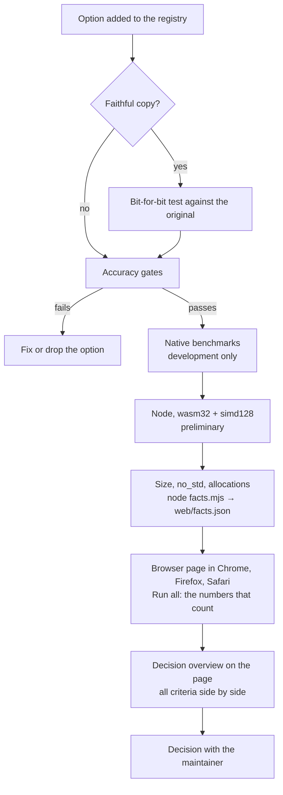

# Testing concept

What the harness tests, against what, and where each threshold comes from.

## Contents

- [Goal](#goal)
- [Three approaches](#three-approaches)
- [Evaluation flow](#evaluation-flow)
- [Options under test](#options-under-test)
- [Test levels](#test-levels)
- [Two references](#two-references)
- [Test signals](#test-signals)
- [Metrics and thresholds](#metrics-and-thresholds)
- [Performance](#performance)
- [Gates besides accuracy](#gates-besides-accuracy)
- [From results to the decision](#from-results-to-the-decision)
- [Not tested here](#not-tested-here)
- [Challenges](#challenges)

## Goal

Four questions decide whether the engine should use the library `realfft`/`rustfft` or its own kernel `simd`.
Each is answered with measured numbers:

| #   | Question                                                                                                                                             | Possible answers                                                         | Decided by                                                                                                                      |
| --- | ---------------------------------------------------------------------------------------------------------------------------------------------------- | ------------------------------------------------------------------------ | ------------------------------------------------------------------------------------------------------------------------------- |
| 1   | How much faster than today's scalar `rfft` are `realfft` and `simd` in wasm?                                                                         | a factor per size, e.g. 8× at N = 1024                                   | time per call; target ≥ 4× for N = 1024–16384, the sizes the engine's consumers use (proposal)                                  |
| 2   | Does that gain hold in every browser? An earlier SIMD pass was faster in Node but slower in the browser and was reverted (`7998a6b64`, `3628e040e`). | yes, or no for browser X                                                 | the same timings in Chrome, Firefox and Safari, with the reverted pass measured alongside                                       |
| 3   | Does a faster FFT noticeably relieve the render thread?                                                                                              | yes or no, per consumer: analyser, time-stretch, Convolver               | share of the 128-frame render quantum, today and with each candidate; time-stretch budget P (proposal: 25 % at 16 regions)      |
| 4   | Library `realfft` or own kernel `simd`?                                                                                                              | `realfft`, `simd`, or neither if question 3 finds no consumer that gains | `realfft` if it passes every gate, takes at most 1.2× the time of `simd` and adds at most S kB; otherwise `simd` (plan; S open) |

Speed only matters for an option that is accurate enough, so accuracy is tested first. The gates below
are pass/fail checks on accuracy; everything else is reported for the person comparing the options.

## Three approaches

To answer them, the same options run in three places. Each answers what the others cannot.

|             | 1. Rust tests, native                                                                                                                                            | 2. Wasm build in Node                                                            | 3. Wasm build in the browser                                                                |
| ----------- | ---------------------------------------------------------------------------------------------------------------------------------------------------------------- | -------------------------------------------------------------------------------- | ------------------------------------------------------------------------------------------- |
| **Run**     | `cargo test`                                                                                                                                                     | `node run.mjs`                                                                   | `node web/serve.mjs`, then **Run all**                                                      |
| **Tests**   | accuracy gates, faithful copies, allocations; size and `no_std` via `size/`                                                                                      | speed per call, per step, render budget                                          | the same timings in Chrome, Firefox and Safari                                              |
| **Why**     | fast and deterministic, with an f64 reference and a counting allocator                                                                                           | the module the engine would ship (wasm32 + SIMD128), scriptable, quick to repeat | the engine runs in browsers, and each compiles wasm its own way ([challenges](#challenges)) |
| **Limits**  | native code, not wasm: its speed says nothing about the decision; `simd` runs its scalar `V4` path there                                                         | V8 only; timings, no accuracy checks; preliminary                                | started by hand per browser; a Worker, not the audio thread                                 |
| **Runbook** | [2. Correctness](runbook.md#2-correctness), [3. Accuracy report](runbook.md#3-accuracy-report), [6. Binary size and no_std](runbook.md#6-binary-size-and-no_std) | [5. Wasm in Node](runbook.md#5-wasm-in-node-with-the-render-budget)              | [7. Browsers](runbook.md#7-browsers)                                                        |

### Gaps between the approaches

- **Accuracy of the wasm build** is not measured in wasm. For `simd` the native tests cover it: the scalar `V4`
  path performs the same operations in the same order as the SIMD128 one, bit for bit.
- **What the browser cannot measure** (accuracy, allocations, size, `no_std`) comes from approach 1 via
  `web/facts.json`, so the page still shows every criterion.

### Rules for every timing

- **Engine build settings:** `+simd128`, opt-level 3, LTO, `panic = "abort"`.
- **Only the transform is timed:** each option's native call (`*_kernel`); data is loaded untimed before every
  call (`prepare_*`), because in-place kernels destroy their input.
- **Statistics:** batches of at least `max(10 ms, 500 × timer tick)`, median of many warm runs, 95 % confidence
  interval with a target half-width ≤ 5 %.
- **Safari:** run by hand, as Playwright WebKit is not Safari.
- **Environment recorded:** CPU, OS, browser and version, git hash, timer tick.
- **Decision runs:** quiet machine, committed tree.

## Evaluation flow

- **Accuracy first:** an option reaches the performance steps only once it passes every accuracy gate.
- **Browser over Node:** Node numbers alone are not enough. The reverted SIMD pass looked fine in Node and was
  slow in the browser.
- **One place to decide:** the page's overview combines this browser's timings with the facts file, so every
  criterion of the plan is in one table.

## Options under test

**Baselines** set the gates, **candidates** must pass them.

| Option         | Role      | What                                                                                                                            |
| -------------- | --------- | ------------------------------------------------------------------------------------------------------------------------------- |
| `analyser`     | baseline  | Size-generic copy of `AudioAnalyser::fft` (full N-point complex)                                                                |
| `rfft`         | baseline  | `dsp::rfft` (real input, N/2 complex + post-twist), used by the Convolver                                                       |
| `signalsmith`  | baseline  | `signalsmith::fft` (full N-point complex), used by the time-stretch                                                             |
| `reverted`     | baseline  | `signalsmith::fft` as of `7998a6b64`, the reverted SIMD pass                                                                    |
| `realfft`      | candidate | `realfft`/`rustfft`, the library alternative from `future-plans/simd-fft.md`; open gate questions: third-party DSP, needs `std` |
| `simd`         | candidate | The own SIMD128 kernel, a prototype: radix-4 Stockham, real input ([how it works](simd-kernel.md))                              |
| `simd-complex` | candidate | The same kernel as a full complex FFT with a stage-wise API, the shape the time-stretch needs                                   |

## Test levels

Levels 1–4 belong to approach 1, level 6 to approach 3.

| Level                    | Question                                                    | Where                                  |
| ------------------------ | ----------------------------------------------------------- | -------------------------------------- |
| 1. Tool self-tests       | Are the reference DFT and the metrics right?                | `tests/accuracy.rs`                    |
| 2. Faithful copies       | Does each copy compute exactly what its original does?      | `tests/faithful_copy.rs`               |
| 3. Baseline sanity       | Are the baselines at f32 resolution?                        | `tests/accuracy.rs`                    |
| 4. Candidate gates       | Does every non-baseline meet the plan's targets?            | `tests/accuracy.rs`                    |
| 5. JavaScript modules    | Are statistics, budget model, runners and page logic right? | `*.test.mjs`, `web/*.test.mjs`         |
| 6. Browser preconditions | Can this browser measure at all?                            | page step ①: isolation, timer, SIMD128 |
| 7. Mutation checks       | Can each test actually fail?                                | by hand, before a test is accepted     |

- **Level 1:** the reference DFT must give known answers (impulse → flat 1, DC → n at bin 0, a sine on
  bin k → amplitude · n/2 at k). The metrics must flag known errors (a doubled spectrum is 100 % off in
  relative RMS and shows 4× the energy in Parseval).
- **Level 2:** bit-for-bit, not within a tolerance. The `analyser` copy against `AudioAnalyser` at its
  own size, 1024. The `reverted` copy against today's `signalsmith::fft`, natively, where it runs its
  scalar `Simd4` fallback.
- **Level 5:** the JavaScript side has no Rust to lean on, so its pure modules are tested on their own:
  statistics against hand-computed values, the budget model against worked examples, the step order,
  charts, report and decision overview against fixtures, including a missing or malformed facts file.
- **Level 6:** a timing taken in a browser that is not cross-origin isolated, has a coarse timer or lacks
  SIMD128 is wrong. The page checks this first and runs nothing else until it passes.
- **Level 7:** each new test is run once against a deliberately broken implementation (a flipped sign,
  f32 instead of f64 twiddles, a 1e-6 scale error) and must fail. The mutation is then reverted.

## Two references

- **Absolute:** an exact DFT of the same f32 input, computed in f64 (`reference::dft`). Twiddles come
  from a table indexed by `(j·k) mod n`, so no angle error accumulates.
- **Output contract:** the analyser's own steps around its FFT (Blackman-Harris window, magnitude in
  f64, scale 1/(n/2)) at N = 1024, compared with `AudioAnalyser`'s bins (`contract.rs`). Editor views
  depend on these bins, so a new FFT must not change them visibly.

## Test signals

Every signal at every size, N = 256, 512, …, 16384 (`signals.rs`).

| Signal           | Definition                                       | Gated             |
| ---------------- | ------------------------------------------------ | ----------------- |
| impulse          | `x[0] = 1`                                       | yes               |
| DC               | `x = 1`                                          | yes               |
| sine on bin      | bin N/32, amplitude 0.5 (the analyser's fixture) | yes               |
| sine off bin     | bin N/32 + 0.5, amplitude 0.5 (worst leakage)    | yes               |
| white noise      | xorshift32, seed `0x12345678`, ±0.2              | yes               |
| full-scale noise | same generator, ±1.0                             | yes               |
| full-scale sine  | bin N/32, amplitude 1.0                          | yes               |
| denormal noise   | same generator, ±1e-39 (every sample subnormal)  | no, reported only |

## Metrics and thresholds

| Metric                | Definition                                        | Threshold                                     | Origin               |
| --------------------- | ------------------------------------------------- | --------------------------------------------- | -------------------- |
| Relative RMS          | `sqrt(Σ\|X − X_ref\|² / Σ\|X_ref\|²)`             | candidate: ≤ 2 × max(`rfft`, εf32) | plan; floor: harness |
| Round trip            | `max \|x − inverse(forward(x))\|`, white noise    | < 1e-5                                        | plan                 |
| Parseval              | relative gap between `Σx²` and `Σ\|X\|² / n`      | reported                                      | plan                 |
| Analyser contract     | `max \|B_new − B_old\| / max \|B_old\|`, N = 1024 | ≤ 1e-5 (≈ −100 dB)                            | plan proposal        |
| Baseline relative RMS | as above                                          | < 1e-6                                        | harness sanity bound |
| Baseline Parseval     | as above                                          | < 1e-6                                        | harness sanity bound |

- **Gate floor:** every option is exact on the impulse (0) and at f64 noise on DC (≈ 1e-15). A plain
  "2× baseline" would then demand a bit-exact candidate. Below one f32 epsilon (1.19e-7) a result is as
  exact as f32 gets, so the gate never drops below 2 × 1.19e-7.
- **Sanity bounds:** 1e-6 is about 6× above the worst measured baseline value. It does not flake, and a
  real bug lands orders of magnitude above it.
- **Denormal input** is not gated: f32 has no precision left there, and the analyser squares in f32, so
  its bins are all zero.

## Performance

Timed in approaches 2 and 3. Criterion benches (`benches/fft.rs`) exist natively for development only.

- **Per step:** where an option can split a transform over render quanta (`signalsmith`, `simd-complex`),
  each step is timed too, because the largest step must fit one quantum.
- **Budget per consumer** (`budget.mjs`): the share of the 128-frame render quantum (2.667 ms at 48 kHz)
  that each consumer's FFTs take at its real call pattern: analyser (N = 1024), time-stretch (N = 4096,
  forward + inverse, two channels per complex call, 1–16 regions) and Convolver (N = 256, 2048, 16384).
  It reports the average and the worst case. The pack, unpack and window work around the FFT is not
  included.
- **Real-input gain** is reported separately from the SIMD gain: the `analyser` runs a full complex
  transform on one real signal, so ≈ 2× is available there without SIMD. `signalsmith` already packs two
  real channels into one complex transform, so it has no such reserve.

## Gates besides accuracy

| Gate                     | Method                                                                                                                                                                                           |
| ------------------------ | ------------------------------------------------------------------------------------------------------------------------------------------------------------------------------------------------ |
| No allocation after plan | counting global allocator: zero allocations in `forward`/`inverse`, every option and size, no warm-up call (`tests/allocation.rs`)                                                               |
| `no_std` (engine, talc)  | link check: a `no_std` wasm stub per option with its own allocator and panic handler, as the engine has (`size/nostd-check.sh`). A dependency on `std` fails with a duplicate `panic_impl`       |
| Binary size              | one small module per option, engine flags (`+simd128`, opt-level 3, LTO, abort, strip), `wasm-opt -Oz` with the engine's feature set, gzip -9; delta to the matching empty stub (`size/size.sh`) |
| Dependency footprint     | crates each stub pulls in (`cargo tree -e normal`), printed by `size/size.sh`                                                                                                                    |

## From results to the decision

The browser page opens with a **decision overview**: one row per criterion, `realfft` and `simd` side by side,
`rfft` as today's reference. Speed rows come from the run in that browser, all others from `web/facts.json`.
Each threshold is marked plan, proposal or open; a value gets ✔ or ✘ only against a plan or proposal. The page
makes no recommendation.

## Not tested here

Production code is never changed by the harness. Replacing any FFT in the engine, the time-stretch and
the Convolver themselves, and the TypeScript `lib-dsp` FFT are out of scope.

## Challenges

Speed is compared as ratios between options. A factor that slows every option alike, such as a lower clock
under heat or load, cancels in a ratio. Only factors that hit options differently distort it:

- **Ratios hold per engine.** V8 (Node, Chrome), SpiderMonkey (Firefox) and JavaScriptCore (Safari) compile
  SIMD128 shuffles, loads and register use differently, so the factor differs per option and engine. A ratio
  from Node predicts a browser only roughly; for the reverted pass it flipped sign. Natively `realfft` uses
  NEON or AVX, so native ratios say nothing about wasm.
- **Every option must see the same load.** Steady load mostly cancels. Two effects remain: other processes
  evict the cache, which hurts an option with large tables and code (`realfft`) more than a small kernel; and
  load that changes during a run hits options measured at different times differently. `run.mjs` and the page
  measure one option after the other per size, seconds apart, not interleaved. A quiet machine and a repeated
  run guard against this; the confidence interval does not show it.
- **The browser timer is coarse.** Browsers coarsen `performance.now()` against Spectre (Chrome: 100 µs, 5 µs
  when cross-origin isolated). One call takes 0.4–30 µs, far below a tick, so the harness times batches of at
  least 500 ticks: rounding stays below 0.2 % per batch. A coarse timer costs measuring time, not accuracy. In
  a browser, single-call times are batch means and a step is the difference of two batches.
