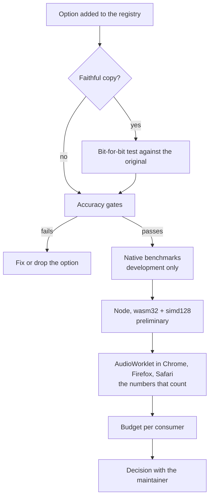

# Workflow

How to work with the harness: running it, adding an option, and taking a measurement.

## Evaluation flow

An option only reaches the performance steps once it passes every accuracy gate. The harness produces
the numbers at each step; the person running it compares them and decides. Node numbers alone are not
enough for that: the reverted SIMD pass looked fine in Node and was slow in the browser.

## Running the harness

All commands from `crates/fft-bench`. The crate is excluded from the workspace, so `cargo` here uses
its own lockfile and `target/`.

| Task                          | Command                                               | Status  |
|-------------------------------|-------------------------------------------------------|---------|
| All tests (≈ 2 s)             | `cargo test`                                          | ready   |
| Accuracy tests only           | `cargo test --test accuracy`                          | ready   |
| Faithful-copy tests only      | `cargo test --test faithful_copy`                     | ready   |
| Allocation test only          | `cargo test --test allocation`                        | ready   |
| Accuracy report (Markdown)    | `cargo run --release --example report > report.md`    | ready   |
| Wasm build check              | `cargo check --target wasm32-unknown-unknown`         | ready   |
| Native benchmarks (≈ 4 min)   | `cargo bench`, filtered: `cargo bench -- forward/rfft` | ready   |
| Node benchmarks (≈ 30 s)      | `cargo build --release --target wasm32-unknown-unknown`, then `node run.mjs`; filtered: `node run.mjs --sizes 1024 --options rfft,realfft` | ready |
| Binary size and `no_std` check| `size/size.sh`, `size/nostd-check.sh`                 | planned |

Tests build with `opt-level = 3` (`[profile.test]`): the f64 reference DFT is O(n²) and too slow
unoptimised at n = 16384.

## Adding an option

The Day-2 prototype enters this way; so would any other kernel.

1. **Implement `RealFft`** in `src/options/<name>.rs`: `new(n)` builds the plan and is the only method
   that may allocate; `forward` takes n samples and writes n/2 + 1 split bins, unnormalised; `inverse`
   returns `false` if the option has none. A full complex FFT can reuse `ComplexAsReal`.
2. **Register it** in `options::ALL` with its role. A candidate is `Role::Candidate`.
3. **Copies only:** add a bit-for-bit test against the original to `tests/faithful_copy.rs`.
4. **Run `cargo test`.** Candidates and the reference are picked up by the gate tests automatically.
5. **Mutation check:** break the option once on purpose (a sign, a twiddle, a scale) and confirm a test
   fails; then revert.
6. **Run the report** and compare its column with the baselines.

Benchmarks and the wasm runner read the same registry, so a registered option is measured without
further changes (once those parts exist).

## Taking a measurement

1. **Clean tree:** commit or stash first, so the build hash identifies the code that was measured.
2. **Quiet machine:** quit every application the measurement does not need (browsers, IDE indexing,
   sync and backup clients, chat, video calls); run on mains power with Low Power Mode off; build first
   and let the machine settle before measuring. A busy machine produced a false 45 % gap between two
   copies of the same code here; the real gap, measured quietly and alternating, was 15 %.
3. **Environment:** native runs print it automatically (CPU, OS, `rustc`, build, `RUSTFLAGS`, git hash
   with a `-dirty` flag, library versions). Add `node` and browser versions by hand where they apply.
4. **Longer runs for numbers that count:** `cargo bench -- --measurement-time 10 --warm-up-time 3`.
   Take the median and the 95 % confidence interval; repeat noisy points until the half-width is ≤ 5 %.
5. **Compare like with like:** two variants are compared in the same run, ideally alternating, never
   across runs taken under different conditions.
6. **Browsers by hand where needed:** Playwright's WebKit is not Safari; Safari is run manually.
7. **Store results outside the crate.** Measurements belong to the evaluation, not to the harness code.

## Rules while working on the harness

- No change to production code (`dsp`, `signalsmith`, the engine). Copies live in the harness.
- f32 only, no allocation after plan creation, twiddles built outside the timed path.
- Small, focused commits; every commit keeps `cargo test` green and the wasm build check passing.
